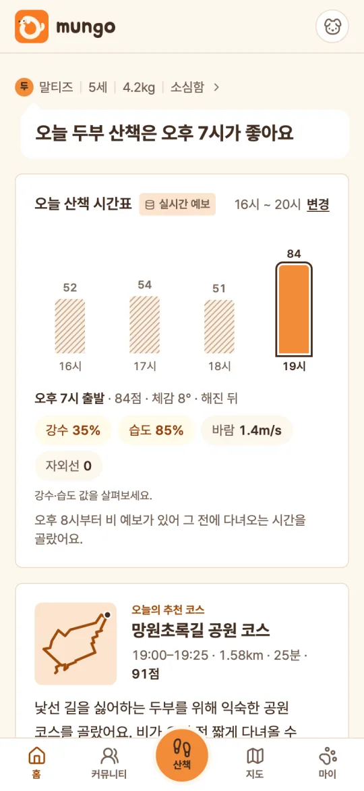
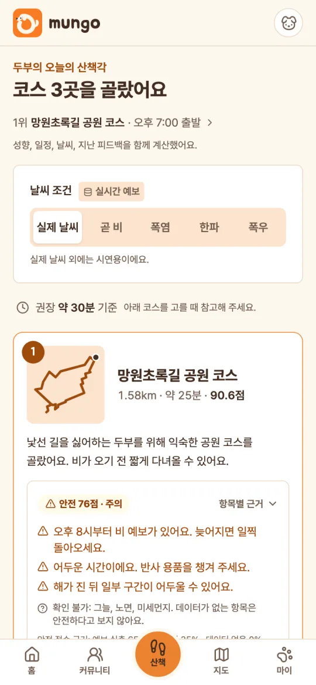
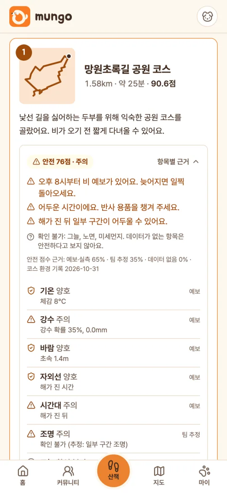
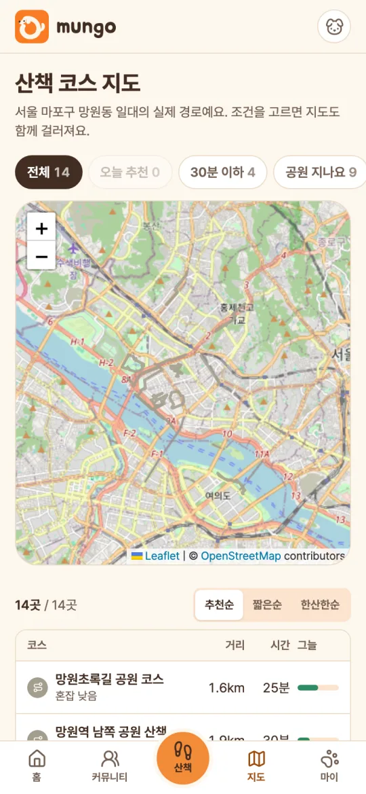
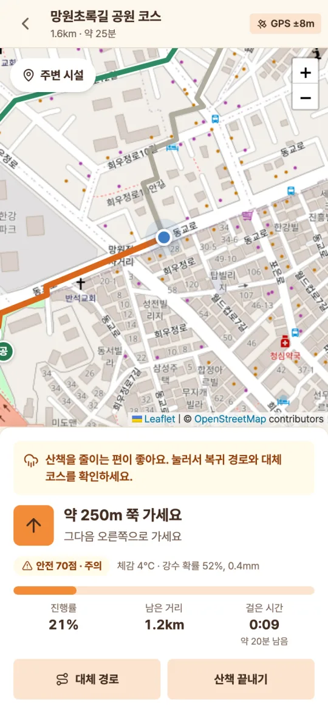
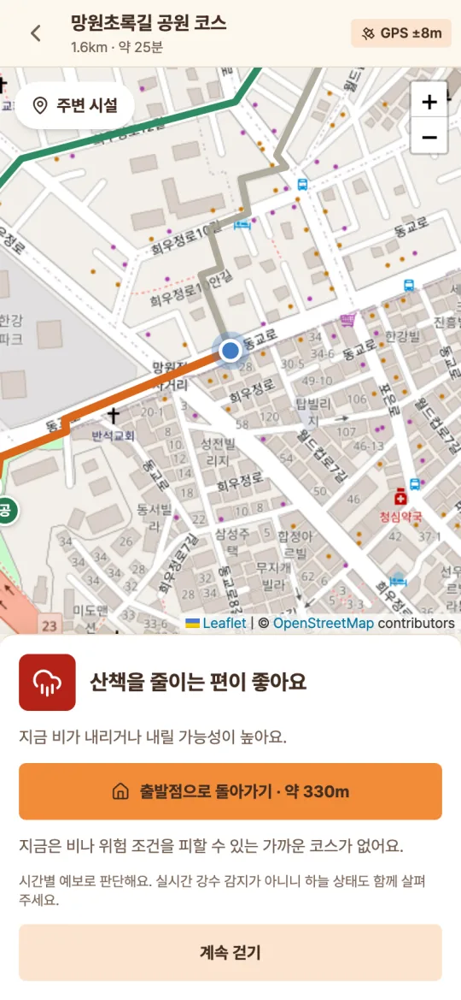
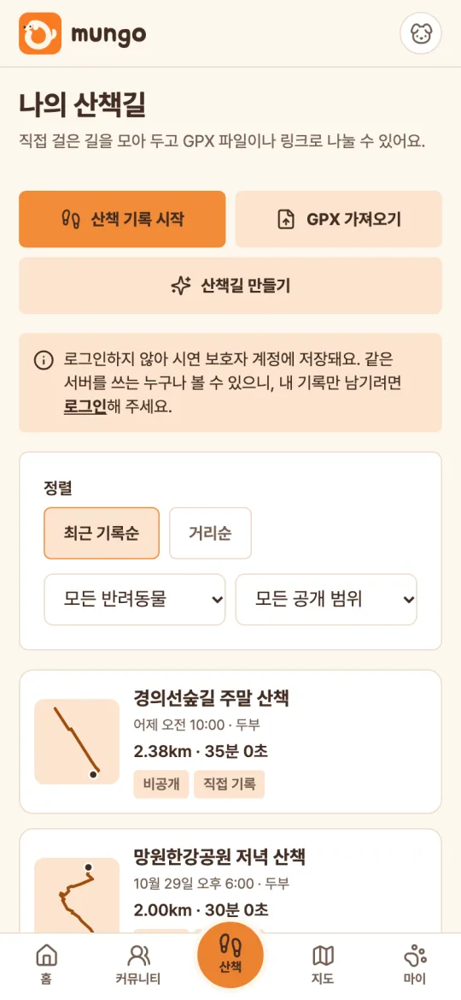
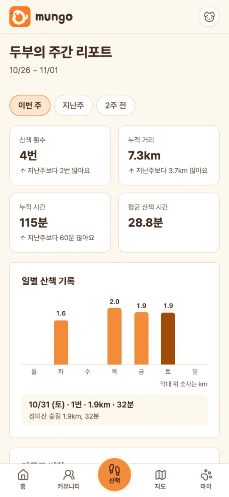
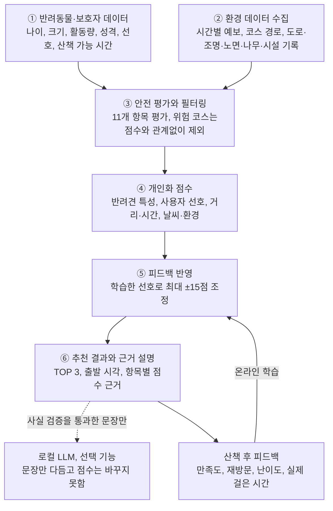
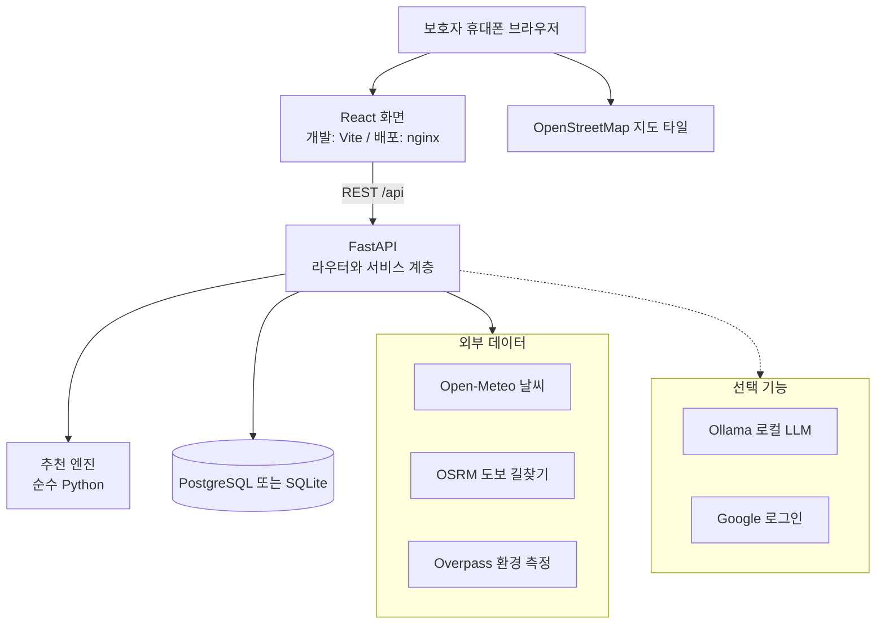

<p align="center"></p>

<h1 align="center">mungo</h1>

<p align="center">
  <b>Every Paw Deserves a Perfect Path.</b><br />
  AI-Powered Personalized Pet Walking Recommendation<br />
  우리 강아지 맞춤 산책 시간과 코스 추천
</p>

<p align="center">
  <a href="https://pawpath.ficklebobo.dev">공개 데모</a> ·
  <a href="#빠른-시작">빠른 시작</a> ·
  <a href="docs/FEATURES.md">기능 정리</a> ·
  <a href="docs/RECOMMENDER.md">추천 알고리즘</a> ·
  <a href="docs/VALIDATION.md">검증 결과</a>
</p>

## 프로젝트 개요

mungo(저장소 이름 PawPath)는 **"오늘 이 아이와 언제, 어디로 걸어야 할까"** 에 답하는 반려견 산책 추천 서비스입니다. 반려동물의 나이, 크기, 활동량, 성격, 산책 선호와 보호자의 일정, 시간별 날씨, 코스 주변 환경(도로, 조명, 노면, 그늘, 시설)을 함께 계산합니다. 위험한 코스를 먼저 걸러 낸 뒤 산책 시간과 코스 TOP 3를 근거와 함께 추천하고, GPS 길 안내로 실제 산책까지 이어 줍니다. 산책 후 남긴 피드백은 다음 추천에 반영합니다.

> 낯선 길을 싫어하는 두부를 위해 익숙한 공원 코스를 골랐어요. 비가 오기 전 짧게 다녀올 수 있어요.

위 문장은 고정 문구가 아니라 두부의 프로필, 코스 데이터, 시간별 예보로 계산해 만든 결과입니다.

*In English: mungo recommends when and where to walk your dog today. A safety-first, rule-based engine we built ourselves combines the dog's profile, the owner's schedule, hourly forecasts and route environment, then learns from post-walk feedback. An optional local LLM only rephrases reasons that pass a fact check; it never sets scores.*

### 해커톤 심사 안내

코디세이 AI 해커톤 2026 출품작입니다(팀 김피탕). 발표자료(PDF)와 시연 영상(MP4)은 팀 구글 드라이브에 올렸고, 심사 기준 커밋 해시는 `팀명_소스코드.txt`에 적었습니다.

| 항목 | 위치 |
|---|---|
| 공개 데모 | https://pawpath.ficklebobo.dev (설치 없이 브라우저로 확인) |
| 로컬 실행 | [빠른 시작](#빠른-시작). Docker와 API 키 없이 `./dev.sh` 한 번으로 실행 |
| 시연 순서 | [시연 시나리오](#시연-시나리오) |
| 활용 AI 기술과 직접 개발 범위 | [동작 원리](#동작-원리), [추천 알고리즘](docs/RECOMMENDER.md), [직접 개발한 범위](docs/EXTERNAL_RESOURCES.md#직접-개발한-범위) |
| 외부 자원 활용 내역 | [외부 자원 활용 내역](docs/EXTERNAL_RESOURCES.md) (오픈소스, 외부 API, 사전 보유 코드, 기타) |
| 구현과 검증 | [기능 정리](docs/FEATURES.md), [검증 결과](docs/VALIDATION.md) |

참가자 가이드의 1차 서면 심사 항목별로 이 저장소에서 볼 곳입니다.

| 평가 항목 | 볼 곳 |
|---|---|
| 기획의 구체성 | [문제](#문제), [해결 방법](#해결-방법), [한계와 로드맵](#한계와-로드맵) |
| 기획의 창의성 | [핵심 가치](#핵심-가치), [동작 원리](#동작-원리) |
| 기술 완성도 (직접 개발) | [동작 원리](#동작-원리), [기술 스택과 선택 이유](#기술-스택과-선택-이유), [추천 알고리즘](docs/RECOMMENDER.md), [시스템 아키텍처](docs/ARCHITECTURE.md) |
| 성과 및 실용 가능성 | [데모](#데모), [검증 결과](#검증-결과), [기능 정리](docs/FEATURES.md) |

API 키 같은 인증정보는 저장소에 넣지 않았습니다. 설정값은 [`.env.example`](.env.example)에 있고, 실제 값은 커밋하지 않는 `.env`에 넣습니다.

## 문제

보호자는 산책할 때마다 네 가지를 동시에 판단합니다.

| 판단 | 보호자가 지금 하는 일 |
|---|---|
| 날씨 | 기온, 비, 바람, 자외선을 시간마다 따로 확인하고 우리 아이에게 괜찮은지 가늠 |
| 반려견 특성 | 나이, 체급, 성격, 더위 민감도에 맞는 산책 강도와 길을 스스로 판단 |
| 보호자 일정 | 가능한 시간 안에 다녀올 수 있는 코스인지 계산 |
| 주변 환경 | 차도, 조명, 노면, 그늘, 시설 같은 현장 위험을 코스마다 비교 |

정보는 날씨 앱, 지도, 커뮤니티에 흩어져 있고 최종 판단은 보호자 몫입니다. 산책 전 탐색이 피곤해지고, 안전한 선택은 늦어집니다. 사람 기준 날씨 앱과 일반 길찾기는 "낯선 길을 싫어하는 노령견" 같은 개체의 사정을 모릅니다.

여러 조건을 한 점수로 합치는 방식에도 함정이 있습니다. 선호 점수가 높으면 위험 요소를 상쇄해 위험한 코스가 위로 올라올 수 있습니다. 실제로 우리가 처음 만든 엔진(v1)을 조건 조합 5,832회로 점검했을 때, 개포동에서 위험 수준 코스가 안전한 코스 위로 온 경우가 2.3%였습니다([분석](docs/RECOMMENDER.md#v1에서-v2로-바꾼-이유)).

**목표 사용자:** 노령견·소형견 보호자, 야간이나 날씨 변화에 민감한 보호자, 아이의 조건에 맞는 코스를 원하는 보호자.

## 해결 방법

mungo는 **언제, 어디로, 왜**를 한 번에 답합니다.

| 문제 | mungo의 해결 | 구현 |
|---|---|---|
| 시간마다 날씨를 따로 확인 | 보호자 일정 안의 출발 시각을 시간별 예보로 반려견 기준 평가해 "오늘 두부 산책은 오후 7시가 좋아요"로 답함 | `recommender/timeslots.py` |
| 반려견 특성을 스스로 판단 | 프로필을 권장 시간·거리, 쾌적·위험 체감온도, 낯선 길·혼잡·오르막 허용도로 변환 | `recommender/features.py` |
| 현장 위험을 코스마다 비교 | 11개 항목 안전 평가, 위험 코스 선제 제외, 더 안전한 대체 코스 | `recommender/safety.py` |
| 선호 점수가 위험을 상쇄 | **안전 선필터**: 안전 단계를 통과한 뒤에만 개인화 점수로 경쟁. 위 2.3% → 0% | `recommender/engine.py` |
| 추천을 믿기 어려움 | 묶음별 점수, 근거, 출처 공개. 추정값은 추정, 데이터 없음은 "확인 불가" | `recommender/explain.py` |
| 아이가 실제로 좋아하는 길을 모름 | 산책 후 피드백을 온라인 학습해 다음 추천에 반영 | `recommender/preference.py` |
| 추천과 실제 산책이 끊김 | 그 코스로 GPS 길 안내, 걷는 중 날씨 재평가, 기록과 피드백까지 한 흐름 | `frontend/src/lib/navigation.ts` |

## 핵심 가치

- **안전이 먼저입니다.** 위험한 코스는 개인화 점수와 관계없이 빠지고, 빠진 이유가 보입니다. 데이터가 없는 항목은 안전하다고 보지 않습니다.
- **우리 아이 기준입니다.** 같은 날씨와 코스라도 노령견, 더위에 약한 아이, 낯선 길을 싫어하는 아이에게 다른 시간과 코스를 권합니다.
- **근거를 보여 줍니다.** 모든 추천 이유와 주의사항은 실제 계산값에서 나오고, 점수 근거와 출처를 화면에서 확인할 수 있습니다.
- **걸을수록 맞춰지되, 흔들리지 않습니다.** 피드백이 쌓일수록 반영 비중이 커지지만 한 번의 평가로 순위가 뒤집히지 않도록 조정 폭을 ±15점으로 제한합니다.
- **추천에서 산책까지 이어집니다.** 추천 카드에서 바로 길 안내를 시작하고, 끝나면 기록과 피드백으로 돌아옵니다.
- **외부 서비스가 실패해도 동작합니다.** 날씨, 길찾기, LLM이 실패해도 모의 날씨, 직선 경로, 계산 문장으로 끝까지 추천합니다.

## 핵심 기능

### 서비스 화면

<table>
  <tr>
    <td align="center" width="33%"><br /><sub><b>홈</b><br />오늘 가장 좋은 산책 시간과 시간대별 점수</sub></td>
    <td align="center" width="33%"><br /><sub><b>AI 산책 코스 추천</b><br />날씨 조건, 코스 TOP 3, 추천 이유</sub></td>
    <td align="center" width="33%"><br /><sub><b>산책 안전 지수</b><br />항목별 상태와 출처, 확인 불가 표시</sub></td>
  </tr>
  <tr>
    <td align="center"><br /><sub><b>코스 지도</b><br />조건으로 거르고 표로 비교</sub></td>
    <td align="center"><br /><sub><b>GPS 길 안내</b><br />회전 안내, 진행률, 걷는 중 안전 상태</sub></td>
    <td align="center"><br /><sub><b>산책 중 재평가</b><br />비 예보가 잡히면 복귀 경로 안내</sub></td>
  </tr>
  <tr>
    <td align="center"><br /><sub><b>나만의 산책길</b><br />GPS 기록, GPX, 산책길 자동 만들기</sub></td>
    <td align="center"><br /><sub><b>산책길 커뮤니티</b><br />출발·도착점을 가린 산책길 공유와 탐색</sub></td>
    <td align="center"><br /><sub><b>주간 리포트</b><br />횟수, 거리, 시간, 지난주 대비</sub></td>
  </tr>
</table>

실제 앱 화면입니다. 2026-11-01 오전에 로컬 서버(망원동, 실제 Open-Meteo 예보, 390px 모바일 화면)에서 캡처했습니다. 산책 기록, 나만의 산책길, 커뮤니티 글은 앱 API로 넣은 시연용 샘플 데이터이고, 커뮤니티의 "샘플 보호자"는 캡처용 테스트 계정입니다.

### 핵심 기능

| 기능 | 하는 일 |
|---|---|
| **개인화 산책 추천** | 반려견 프로필(펫밸런스)과 시간별 강수·기온·바람·자외선(비켜비)으로 보호자 일정 안의 출발 시각과 코스 TOP 3를 고름 |
| **안전 선필터와 안전 지수** | 11개 항목을 평가해 위험 코스를 제외하고 대체 코스를 제안. 해가 진 뒤에는 조명 비중을 높임(안심귀가) |
| **피드백 학습** | 만족도, 재방문, 난이도, 실제 걸은 시간으로 코스 선호, 비슷한 코스, 시간대, 선호 거리, 걸음 속도를 학습하고 변화 폭을 보여 줌 |
| **근거 있는 설명과 AI 문장** | 계산값으로만 추천 이유를 만들고, 로컬 LLM(선택)은 사실 검증을 통과한 문장만 다듬음 |
| **GPS 길 안내와 재평가** | 출발점까지 도보 안내, 회전과 진행률, 이탈 시 재탐색, 걷는 중 날씨가 나빠지면 복귀 경로와 대체 코스 |

**부가 기능:** 나만의 산책길(GPS 기록, GPX 가져오기·내보내기, 사진, 공유 링크), 산책길 자동 만들기, 저장한 길을 내 추천 후보로, 산책길 커뮤니티, 주간 리포트, 여러 반려동물, Google 로그인과 가족 프로필, 즉시 탈퇴, 백업과 복구.

기능마다 해결하려는 문제, 구현 상태, 검증 상태는 [기능 정리](docs/FEATURES.md)에, 화면별 사용법은 [기능 안내](docs/GUIDE.md)에 있습니다.

## 동작 원리

추천 순위와 점수는 외부 AI를 부르지 않고 직접 구현한 **규칙 기반 개인화 모델(추천 v2, `rule-v2`)과 온라인 피드백 학습**으로 계산합니다. 안전은 점수의 한 항목이 아니라 개인화보다 먼저 적용하는 필터입니다.



| 단계 | 처리 | 코드 |
|---|---|---|
| ① 입력 | 프로필을 생애 단계, 권장 산책 시간과 거리, 낯선 길·혼잡·오르막 허용도, 쾌적 체감온도 구간 같은 특성값으로 바꿉니다. | `recommender/features.py` |
| ② 환경 데이터 | Open-Meteo 시간별 예보(30분 캐시)와 미리 구축한 코스 경로(OSRM), OpenStreetMap의 도로·조명·노면·나무·시설 기록을 씁니다. 날씨 API가 실패하면 모의 날씨로 시간표만 계산하고 날씨 항목은 "확인 불가"로 둡니다. | `services/`, `app/data/` |
| ③ 안전 | 항목마다 양호, 주의, 위험, 확인 불가와 출처(예보, OSM 기록, 팀 추정)를 매깁니다. 위험한 날씨와 차단 조건은 이유와 함께 제외하고, 위험 수준 코스는 점수가 높아도 뒤로 보냅니다. | `recommender/safety.py` |
| ④ 개인화 | 코스마다 가능한 출발 시각을 모두 평가합니다. 반려견 특성 25%, 사용자 선호 25%, 거리·시간 20%, 날씨·환경 15%이고, 데이터가 없는 묶음은 빼고 가중치를 다시 나눕니다. | `recommender/course_scoring.py` |
| ⑤ 피드백 | 코스 선호는 최근 피드백 가중 베이즈 축소 평균, 비슷한 코스로의 일반화는 정규화 LMS 선형 모델로 학습합니다. 피드백 비중은 `15% × n/(n+1)`로 건수에 따라 커집니다. | `recommender/preference.py` |
| ⑥ 결과와 설명 | 안전 단계, 점수 순으로 TOP 3를 고르고 경로가 겹치는 코스는 한 번만 올립니다. 항목별 근거와 출처를 계산값으로만 만듭니다. | `recommender/engine.py`, `explain.py` |

**LLM은 점수를 정하지 않습니다.** 엔진이 순위와 점수를 확정해 저장한 뒤, 선택 기능인 로컬 LLM(Ollama, Gemma 4)이 점수를 뺀 근거 자료로 문장만 다듬습니다. `explain_guard.py`가 이름, 길이, 단정 표현, 위치 표현, 확인 불가 항목, 근거 없는 시설과 숫자를 검사해 통과한 문장만 쓰고, 아니면 계산 결과로 만든 문장을 그대로 씁니다. 날씨를 확인하지 못한 추천은 LLM 문장을 만들지 않습니다.

| 구성 | 상태 |
|---|---|
| 규칙 기반 개인화 점수(v2)와 안전 단계 | 구현, 기본값. `RECOMMENDER_VERSION=v1`로 이전 6항목 가중합으로 되돌릴 수 있음 |
| 온라인 피드백 학습(베이즈 축소 평균, 정규화 LMS) | 구현. 외부 ML 라이브러리 없이 순수 Python |
| LLM 추천 문장 | 구현(선택). 로컬 Ollama만 지원. 점수와 순위에 관여하지 않음 |
| 학습 순위 모델(LightGBM 등) | **미구현(계획).** 실제 피드백 데이터가 없어 `Ranker` 인터페이스만 분리해 둠 |
| 추천 성능 지표 | Precision@3, NDCG@3 등을 계산하는 도구는 구현. 지금 있는 수치는 조건 조합과 합성 사용자로 낸 값이며 **실제 사용자 성능이 아님** |

산식, 가중치, 임계값, 대체 전략, 평가 방법은 [추천 알고리즘](docs/RECOMMENDER.md)에, 추천에서 피드백까지의 데이터 흐름은 [시스템 아키텍처](docs/ARCHITECTURE.md#추천-흐름)에 있습니다.

## 기술 스택과 선택 이유

버전은 `frontend/package-lock.json`, `backend/uv.lock`, Dockerfile에 고정된 값입니다.

| 영역 | 기술 | 선택 이유 |
|---|---|---|
| 추천 엔진 | 직접 구현한 순수 Python 모듈(`backend/app/recommender`) | 실제 피드백이 0건이고 코스가 지역당 6~10개라 학습 순위 모델의 입력이 부족함. 규칙 기반은 같은 입력에 같은 순위를 내고 모든 점수를 설명할 수 있음. 순위 계산은 `Ranker`로 분리해 데이터가 쌓이면 교체 가능 |
| 백엔드 | Python 3.12, FastAPI 0.162, Pydantic 2.14, SQLAlchemy 2.1, Alembic 1.20, HTTPX 0.28, uv | 요청 스키마 검증과 Swagger 문서(`/docs`)를 함께 얻음. 같은 모델과 리비전으로 SQLite와 PostgreSQL을 함께 지원 |
| DB | SQLite(로컬 기본), PostgreSQL 18.6(배포) | SQLite는 Docker 없이 `./dev.sh` 하나로 재현됨. 개발용 PostgreSQL은 배포와 같은 이미지를 씀 |
| 프론트엔드 | React 19.3, TypeScript 5.9, Vite 6.4, Tailwind CSS 4.3, React Router 7.18, lucide-react | 휴대폰 브라우저를 주 무대로 한 모바일 웹. 설치 없이 공개 주소로 바로 씀 |
| 지도, 날씨, 길찾기 | Leaflet 1.9 + OpenStreetMap, Open-Meteo, OSRM, Overpass | API 키 없이 동작. 실패하면 모의 날씨, 직선 경로로 끝까지 동작 |
| 길 안내와 기록 계산 | 브라우저 안의 순수 TypeScript 모듈 | 코스 위 위치를 서버로 보내지 않고 계산. 지도와 서버 없이 테스트 가능 |
| AI 문장 | Ollama + Gemma 4(`gemma4:e4b`, 로컬, 선택) | API 키 없이 해커톤 GPU 서버에서 실행. 근거 없는 문장은 `explain_guard.py`가 걸러 씀 |
| 인증 | Google OAuth 2.0 / OpenID Connect | 별도 OAuth·암호 라이브러리 없이 HTTPX로 PKCE, state, nonce, ID 토큰 확인을 직접 구현 |
| GPX | 표준 라이브러리 expat 기반 파서 | 별도 GPX 라이브러리 없이 XXE와 엔티티 폭탄을 차단 |
| 테스트 | pytest 9.2, Playwright 1.64 | 백엔드 단위·API 테스트와 모바일 브라우저 E2E |
| 배포 | Docker Compose, nginx 1.30, OSRM(선택), Cloudflare Tunnel | 배포 서버가 내부망이라 인바운드 없이 공개 주소로 연결 |

## 시스템 아키텍처



- **화면**(`frontend/src`): 모바일 웹 우선. GPS 길 안내와 산책 기록 계산은 브라우저에서 합니다.
- **API와 서비스**(`backend/app`): 요청 검증, DB와 엔진 연결, 날씨 캐시와 폴백, 피드백 반영. API 경로 91개.
- **배포**: `compose.prod.yaml`이 DB, API, 웹, 길찾기를 컨테이너로 띄우고 Cloudflare Tunnel로 공개합니다([배포](docs/DEPLOY.md)).

프론트엔드·백엔드·DB 구조, 인증 흐름, 외부 API 연동, 데이터 흐름, 보안 고려사항은 [시스템 아키텍처](docs/ARCHITECTURE.md)에 있습니다.

## 데모

- **공개 데모:** https://pawpath.ficklebobo.dev
- **시연 영상:** 팀 구글 드라이브에 제출했습니다(저장소에는 없음).

### 시연 시나리오

1. **홈:** 두부 이름표와 "두부 산책은 ○시가 좋아요" 한 줄 답, 시간대별 점수 막대를 봅니다. 막대를 누르면 그 시간의 강수·습도·바람·자외선이 바뀝니다. **다른 코스와 추천 근거 보기**로 추천 화면으로 갑니다.
2. **추천:** 날씨 조건에서 **곧 비**를 고릅니다. 추천 문장과 코스 TOP 3, 안전 평가, **점수 근거 보기**를 볼 수 있습니다. 피드백을 남기기 전이라면 어느 시각에 시연해도 같은 문장이 나옵니다. AI 문장을 켜면 이 문장 대신 AI 문장이 표시됩니다.
3. **지도:** **30분 이하**, **그늘 많음** 같은 조건으로 코스를 거르고 표로 비교합니다. 줄을 누르면 경로, 주변 시설, 데이터 출처가 펼쳐집니다. 줄을 왼쪽으로 밀면 바로 산책을 시작합니다.
4. **산책:** 추천 화면 2위 코스의 **산책** 버튼을 누르면 길 안내 지도가 열립니다. 서비스 지역이 아닌 곳에서 시연한다면 **시연용 위치로 걷기**를 누르세요. 코스를 따라 움직이며 안내가 바뀝니다. **산책 끝내기**를 누르고 만족도 5점 피드백을 남깁니다.
5. **달라진 추천 보기:** 5점을 준 코스의 점수가 오르고 추천 이유에 "지난번 만족도가 높았던"이 붙습니다. 추천 v2는 피드백 한 번에 순위가 뒤집히지 않도록 반영 폭을 제한하므로, 시연 보호자 두부는 같은 코스에 5점을 한 번 더 남기면 1위로 올라옵니다.
6. **마이와 주간 리포트:** 코스 선호도, 학습된 취향, 시간대 선호, 최근 피드백 5건을 확인합니다. 주간 리포트에서는 시연용 산책이 통계에서 빠진 것도 볼 수 있습니다.

**실제 날씨** 외의 조건(곧 비, 폭염, 한파, 폭우)은 시연용 시나리오이며 화면에 그렇게 표시됩니다. 폭염에서는 더운 시간과 그늘을 확인할 수 없는 긴 코스가 제외되고, 폭우에서는 실내 대안을 안내합니다. 산책 중 날씨 변화를 보려면 시연용 위치로 걷는 도중 **시연: 지금부터 비 내리기**를 누르세요. 복귀 경로와 대체 코스가 안내되고, **출발점으로 돌아가기**를 고르면 복귀 안내가 시작됩니다.

시연 내용을 지우는 방법은 [시연 데이터 지우기](docs/SETUP.md#시연-데이터-지우기)에 있습니다.

## 빠른 시작

필요 도구: Python 3.12 이상, [uv](https://docs.astral.sh/uv/), Node.js 20 이상. API 키는 필요 없습니다. `uv`가 Python도 자동으로 준비합니다.

### 1. 설치 없이 바로 실행 (SQLite, 권장)

```bash
git clone https://github.com/Kim-pitang/pawpath.git
cd pawpath
./dev.sh
```

`.env` 없이 실행하면 Docker 없이 SQLite 파일(`backend/pawpath.db`)로 동작합니다. 의존성 설치부터 백엔드와 프론트엔드 실행까지 한 번에 하고, `Ctrl+C`로 함께 종료합니다. Windows에서는 PowerShell에서 `.\dev.ps1`을 실행합니다.

### 2. PostgreSQL로 실행 (선택, Docker 필요)

```bash
cp .env.example .env   # POSTGRES_PASSWORD와 DATABASE_URL의 비밀번호를 같은 값으로 바꾸세요
./dev.sh
```

`DATABASE_URL`이 이 컴퓨터의 PostgreSQL을 가리키면 `dev.sh`가 `docker compose`로 DB를 먼저 띄웁니다. 운영 방법은 [PostgreSQL 운영](docs/POSTGRES.md)에 있습니다.

### 실행 후 접속

- 앱: http://localhost:5173
- API 문서(Swagger): http://localhost:8000/docs

처음 실행하면 테이블을 만들고 산책 코스(망원동 10개, 개포동 6개, 공개 GPX 코스 20개), 시연용 반려동물 두부, 기본 일정(16~20시)을 넣습니다. 기본 지역은 망원동입니다.

### 설정과 선택 기능

설정 없이 바로 동작합니다. 값을 바꾸려면 `.env`를 만들고 서버를 다시 시작하세요. 각 변수의 기본값과 설명은 [설치, 설정, 테스트](docs/SETUP.md#환경변수)에 있습니다.

<details>
<summary>환경변수 목록</summary>

| 묶음 | 변수 |
|---|---|
| DB | `DATABASE_URL`, `DB_POOL_SIZE`, `DB_MAX_OVERFLOW`, `DB_POOL_TIMEOUT_SECONDS` (DB 컨테이너: `POSTGRES_USER`, `POSTGRES_PASSWORD`, `POSTGRES_DB`, `POSTGRES_PORT`) |
| 날씨 | `WEATHER_PROVIDER`, `WEATHER_CACHE_MINUTES`, `WEATHER_TIMEOUT_SECONDS` |
| 서비스 지역 | `SERVICE_AREA`, `SERVICE_LATITUDE`, `SERVICE_LONGITUDE`, `SERVICE_TIMEZONE` |
| 길찾기 | `ROUTING_PROVIDER`, `ROUTING_BASE_URL`, `ROUTING_TIMEOUT_SECONDS`, `ROUTING_MAX_DISTANCE_KM`, `ROUTING_MIN_INTERVAL_SECONDS` |
| 산책길 자동 생성 | `GENERATION_MAX_SECONDS`, `GENERATION_COOLDOWN_SECONDS`, `GENERATION_BEARINGS`, `GENERATION_RADIUS_SCALES`, `GENERATION_SPREADS`, `GENERATION_MAX_REQUESTS`, `GENERATION_POOL_SIZE`, `GENERATION_MAX_RESULTS` |
| 코스 환경 측정 | `ENVIRONMENT_PROVIDER` |
| 추천 | `RECOMMENDER_VERSION`, `RECOMMENDER_WEIGHTS` |
| AI 추천 문장 | `LLM_PROVIDER`, `LLM_BASE_URL`, `LLM_MODEL`, `LLM_TIMEOUT_SECONDS` |
| 로그인 | `AUTH_REQUIRED`, `GOOGLE_CLIENT_ID`, `GOOGLE_CLIENT_SECRET`, `GOOGLE_REDIRECT_URI`, `E2E_LOGIN` |
| 서버 | `CORS_ORIGINS`, `SEED_DEMO_PET` |
| 백업 | `BACKUP_ENABLED`, `BACKUP_DIR`, `BACKUP_INTERVAL_HOURS`, `BACKUP_RETENTION_DAYS` |

</details>

| 하고 싶은 것 | 안내 |
|---|---|
| AI 추천 문장 켜기 (Ollama) | [AI 추천 문장 켜기](docs/SETUP.md#ai-추천-문장-켜기) |
| Google 로그인 켜기 | [Google 로그인 켜기](docs/SETUP.md#google-로그인-켜기) |
| 개포동(발표장 근처) 코스로 전환 | [개포동 코스로 전환](docs/SETUP.md#개포동-코스로-전환) |
| 휴대폰에서 실제 GPS로 걷기 (HTTPS 터널) | [휴대폰에서 실제 GPS 쓰기](docs/SETUP.md#휴대폰에서-실제-gps-쓰기) |
| 테스트 실행 | [테스트](docs/SETUP.md#테스트) |
| 백업과 복구 | [백업 및 복구 정책](docs/BACKUP.md), [PostgreSQL 백업](docs/POSTGRES.md#백업과-복구) |
| 서버에 배포 | [배포](docs/DEPLOY.md) |

## 검증 결과

2026-11-01, 커밋 `5f74f2d`를 임시 폴더에 풀어 다시 실행한 결과입니다. 검증 방법을 섞지 않고 나눠 적습니다.

| 검증 방법 | 결과 |
|---|---|
| 백엔드 자동 테스트 (pytest) | **826개 통과**, 6개 건너뜀(PostgreSQL 대상이 필요한 이전 도구 테스트), 실패 0 |
| 타입 검사와 프로덕션 빌드 | 통과 |
| 브라우저 E2E (Playwright, Pixel 7 Chromium) | **158개 통과**, 실패 0. iPhone 13 WebKit은 이전 기록 |
| 추천 시나리오 | 신규 사용자, 고령, 폭염·한파, 폭우, 날씨 누락, 안전 정보 누락, 만족도 높은·낮은 코스, 일관성 등 26개 시나리오가 위 pytest에 포함되어 통과 |
| API 명세 | 실제 라우터의 경로 91개와 [API 명세](docs/API.md)가 일치 |
| 실제 외부 서비스 | Open-Meteo, OSRM, Overpass, 로컬 Ollama, Google 로그인을 실제로 연결해 확인한 기록 |
| 실제 휴대폰 야외 도보 | **미검증.** GPS 길 안내와 산책 기록은 브라우저 위치 에뮬레이션으로만 확인 |
| 추천 품질 | 조건 조합 5,832회와 합성 사용자 120마리로 v1과 비교한 **시뮬레이션만** 있음. 실제 사용자 데이터 기반 평가는 없음 |

테스트 환경, 보안 테스트, 기능별 세부 기록, 검증하지 못한 항목은 [검증 결과](docs/VALIDATION.md)에 있습니다.

## 한계와 로드맵

### 현재 한계

- **실제 환경:** GPS 길 안내, 산책 기록, 커뮤니티를 실제 휴대폰으로 야외에서 걸어 보지 않았습니다. iPhone은 WebKit 엔진으로만 확인했습니다.
- **실제 사용자 데이터:** 없습니다. 추천 성능 수치는 시뮬레이션이며, 가중치와 위험 기준은 서비스 휴리스틱으로 수의학적으로 검증하지 않았습니다.
- **코스 데이터:** 혼잡도, 그늘, 난이도는 팀 추정이고 조명은 대부분 "확인 불가"입니다. 팀이 코스를 현장에서 걸어 보지 않았습니다. 서비스 지역은 망원동과 개포동이며 서버 설정으로만 바꿉니다.
- **날씨:** 시간별 예보로 판단합니다. 실시간 강수 감지와 미세먼지 데이터는 없습니다.
- **웹의 한계:** 화면이 꺼지면 브라우저가 위치 수집을 멈춰 백그라운드 기록을 하지 못합니다.
- **운영:** 앱 내장 자동 백업과 복구 명령은 SQLite만 지원합니다. PostgreSQL은 배포 서버 cron이 매일 `pg_dump`로 백업하고 복구는 직접 합니다. 관리자 기능과 커뮤니티 신고 기능은 없습니다.

기능별 상태는 [기능 정리](docs/FEATURES.md#planned와-not-implemented)에 있습니다.

### 로드맵 (계획, 구현되지 않음)

| 단계 | 할 일 | 확인할 것 |
|---|---|---|
| 1. 사용자 파일럿 | 실제 보호자에게 쓰게 하고 `recommendation_report online` 지표 수집, 선택 이유 인터뷰 | 선택률, 완주율, 만족도, 재이용 |
| 2. 지역과 데이터 확장 | 미세먼지(Open-Meteo Air Quality) 연결, 추가 지역과 코스, 시설과 조명 데이터 보강, 저장하지 않는 조건의 위치 기반 거리 | 확인 불가 비중, 추천 가능 지역 |
| 3. Ranker 비교 | 쌓인 `recommendation_items`와 피드백으로 학습 순위 모델(LightGBM 등)을 규칙 기반과 같은 지표로 비교. 안전 단계는 앞 단계 필터로 유지 | 안전 지표를 해치지 않으면서 NDCG@3과 평균 만족도 개선 여부 |

## 문서

| 문서 | 내용 |
|---|---|
| [기능 정리](docs/FEATURES.md) | 기능별 해결하려는 문제, 사용자 가치, 구현 상태, 검증 상태 |
| [기능 안내](docs/GUIDE.md) | 시작하기부터 피드백, 커뮤니티, 계정 관리, 개인정보까지 사용 흐름 |
| [추천 알고리즘](docs/RECOMMENDER.md) | 설계 목표, 입력 특성, 안전 평가, 산식, 랭킹, 피드백 학습, LLM, 대체 전략, 평가 방법, 한계 |
| [시스템 아키텍처](docs/ARCHITECTURE.md) | 전체 구조, 프론트엔드·백엔드·DB, 인증, 추천·GPS 흐름, 외부 API, 데이터 흐름, 배포, 보안 |
| [API 명세](docs/API.md) | 인증, 요청·응답 형식, 페이지 나누기, 엔드포인트 91개 |
| [검증 결과](docs/VALIDATION.md) | 테스트 환경, 자동 테스트, 보안 테스트, 수동 검증, 알려진 문제 |
| [설치, 설정, 테스트](docs/SETUP.md) | 실행 방법, 환경변수 전체, 선택 기능 켜기, 지역 전환, 휴대폰 GPS, 프로젝트 구조 |
| [배포](docs/DEPLOY.md) | `compose.prod.yaml`로 DB, API, 웹, 길찾기, 터널을 컨테이너로 운영 |
| [PostgreSQL 운영](docs/POSTGRES.md) | 로컬과 배포의 DB, Alembic, SQLite 데이터 옮기기, pg_dump 백업과 복구, 한계 |
| [백업 및 복구 정책](docs/BACKUP.md) | 기준, 명령, 복구하면 달라지는 것, 탈퇴와 백업, 한계 |
| [GPX 후보 코스](docs/GPX_COURSES.md) | 공개 GPX 20개를 추천 후보로 적재한 방법과 결과 |
| [외부 자원 활용 내역](docs/EXTERNAL_RESOURCES.md) | 오픈소스, 외부 API, 데이터, 도구와 라이선스, 직접 개발한 범위 |
| [PRODUCT.md](PRODUCT.md) | 제품 정의, 사용자, 브랜드(mungo)와 디자인 원칙 |

실행 중에 쓰거나 코스 데이터를 만들 때 쓴 외부 데이터입니다.

| 외부 데이터 | 용도 | 라이선스 |
|---|---|---|
| [OpenStreetMap](https://www.openstreetmap.org/copyright) | 지도 타일, 코스 경로, 주변 시설, 도로·조명·노면·나무 기록 | ODbL 1.0 |
| [Open-Meteo](https://open-meteo.com/) | 시간별 예보 | CC BY 4.0 |
| OSRM 도보 경로 (routing.openstreetmap.de) | 코스 경로 구축, 출발점 길찾기, 복귀 경로, 이탈 시 재탐색 | 데이터 ODbL |
| Overpass API | 코스 주변 환경 수집, 내 산책길 환경 측정 | 데이터 ODbL |
| Geofabrik OpenStreetMap 추출본 | 산책길 자동 생성용 서울 환경 타일(데이터 구축 때만) | 데이터 ODbL |
| Valhalla 공개 보행 경로 서버 | 서울 20개 구 GPX 후보 코스의 경로 계산(데이터 구축 때만) | 데이터 ODbL |

**데이터와 안전에 관한 안내:** 안전 점수와 날씨 적합도는 환경 위험을 비교하는 참고값이며 의학적, 절대적 안전을 보장하지 않습니다. 혼잡도, 그늘, 난이도는 팀 추정값입니다. 위치, 공유, 사진의 개인정보 처리는 [기능 안내](docs/GUIDE.md#12-개인정보-및-주의사항)에 있습니다.

지도 데이터 © OpenStreetMap contributors. 날씨 데이터 Open-Meteo.
