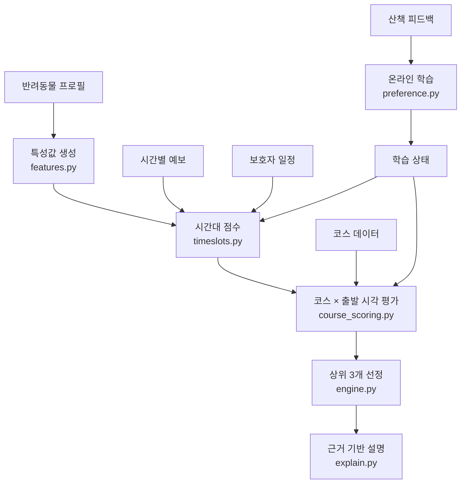
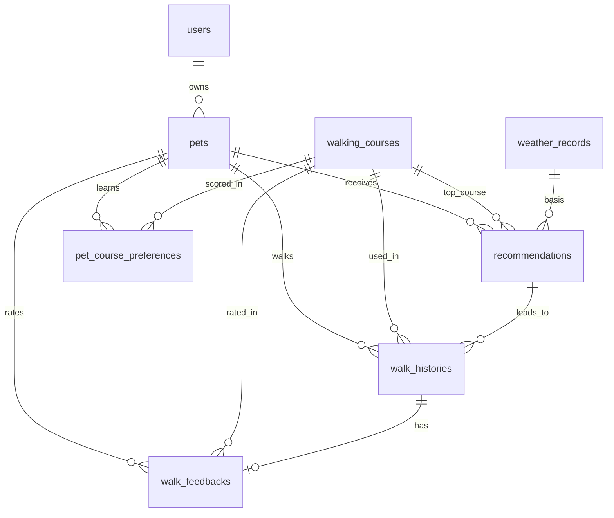

# PawPath 시스템 아키텍처

PawPath(댕댕 산책각)는 반려동물의 특성, 보호자의 일정, 날씨, 동네 환경을 함께 계산해 산책 시간과 코스를 추천하고, 산책 후 피드백을 학습해 다음 추천을 바꾸는 서비스입니다.

## 구성


| 계층 | 위치 | 역할 |
|---|---|---|
| 화면 | `frontend/src/pages` | 대시보드, 프로필, 추천, 지도, 산책 기록, 마이페이지 |
| API | `backend/app/api.py` | 요청 검증과 응답 구성 |
| 서비스 | `backend/app/services` | DB와 엔진 연결, 날씨 폴백, 피드백 반영 |
| 추천 엔진 | `backend/app/recommender` | 모든 추천 판단. DB와 웹 프레임워크에 의존하지 않음 |
| 코스 데이터 | `scripts/build_courses.py` → `backend/app/data/courses.json` | 경로와 시설을 미리 수집해 저장. 실행 중 외부 의존 없음 |

## 추천 파이프라인



### 1. 특성값 (`features.py`)

나이, 크기, 체중, 활동량, 성격, 산책 선호도, 더위 민감도, 낯선 환경 반응을 다음 값으로 변환합니다.

- 생애 단계(크기별 노령 기준), 권장 산책 시간과 거리
- 낯선 길 허용도, 혼잡 허용도, 오르막 허용도
- 쾌적 체감온도 구간과 산책 제외 온도

이 값들은 일반적인 산책 지침을 참고한 서비스 휴리스틱이며 수의학적 기준이 아닙니다.

### 2. 시간대 점수 (`timeslots.py`)

지금부터 24시간 안의 가능 시간대를 정시 단위로 평가합니다.

```
시간대 점수 = 0.55 × 날씨 쾌적도 + 0.15 × 일정 적합 + 0.10 × 일조 + 0.10 × 학습된 시간대 선호 + 0.10 × 가까운 시간
```

- 날씨 쾌적도는 체감온도, 강수, 바람, 자외선을 반려동물 기준으로 평가하며, 산책 구간의 평균과 최악값을 함께 봅니다.
- 강한 비(시간당 3mm 이상), 제외 온도, 강풍인 시간은 추천에서 제외합니다.
- 추위와 더위가 심하면 권장 시간을 줄이고, 비가 오기 전까지만 걷도록 시간을 맞춥니다.
- 산책 희망 횟수만큼, 3시간 이상 떨어진 시간대를 고릅니다.

### 3. 코스 점수 (`course_scoring.py`)

코스마다 가능한 출발 시각을 모두 평가해 가장 좋은 시각을 찾습니다. 각 항목은 0~100점이며 최종 점수는 가중합입니다.

| 항목 | 초기 가중치 | 계산 근거 |
|---|---:|---|
| 날씨 적합도 | 25% | 구간 쾌적도, 그늘, 포장 여부, 강변 바람, 비 겹침 |
| 반려동물 성향 적합도 | 25% | 익숙함과 낯선 길 허용도, 혼잡도, 성격별 선호 |
| 활동량 적합도 | 15% | 권장 거리 대비 코스 거리, 오르막. 추위와 더위에는 권장 거리를 줄임 |
| 보호자 일정 적합도 | 15% | 희망 시간 대비 소요 시간, 가능 시간 초과 여부 |
| 안전 시설 적합도 | 10% | 조명(해 진 뒤 비중 상승), 차량 노출, 공원, 포장, 확인된 시설 |
| 과거 선호도 | 10% (학습에 따라 최대 30%) | 학습된 코스 선호도. 피드백이 없으면 정확히 50점 |

다섯 항목의 가중치는 항상 고정입니다. 피드백이 n건 쌓이면 과거 선호도의 반영 강도만 `g = 10% + 20% × n/(n+2)`로 높입니다.

```
최종 점수 = Σ(가중치 × 항목 점수) + 10% × 50 + g × (과거 선호도 − 50)
```

피드백이 없으면 `g = 10%`이므로 기획서의 가중합과 정확히 같습니다. 중립값에서 벗어난 만큼만 강해지므로, 좋은 피드백은 항상 점수를 올리고 평가하지 않은 코스는 깎이지 않습니다.

### 4. 피드백 학습 (`preference.py`)

외부 AI 호출 없이 직접 구현한 온라인 학습입니다.

| 학습 대상 | 방식 | 효과 |
|---|---|---|
| 코스 선호도 | 최근 피드백 가중 베이즈 축소 평균 (사전값 50) | 표본이 적을 때 극단값을 막고, 최근 경험을 더 반영 |
| 코스 특성 가중치 | 정규화 LMS 선형 모델 (특성 11개) | 피드백이 비슷한 코스로 일반화되어, 가 보지 않은 코스도 예측 |
| 시간대 선호 | 시간대별 축소 평균 | 실제로 좋았던 시간대를 우선 |

피드백은 산책 만족도, 반려동물 만족도, 재방문 의향, 난이도를 합쳐 0~100점 신호로 바꿉니다. 코스 선호도에서는 날씨 만족도를 뺍니다. 비 오는 날의 나쁜 경험은 코스 탓이 아닐 수 있어서, 날씨가 나빴던 산책은 표본 가중치를 절반으로 줄입니다.

그 밖의 규칙은 다음과 같습니다.

- 익숙한 길을 좋아하는 반려동물은 좋았던 코스에 가산점을 받습니다.
- 새로운 길을 좋아하는 반려동물은 세 번 이상 간 코스에서 감점됩니다.
- 싫어한 코스는 자주 가도 "익숙해서 좋은 코스"로 치지 않습니다.

엔진은 같은 날씨에서 학습 상태만 비운 기준선을 함께 계산합니다. 응답의 `learning_delta`와 `rank_change`는 이 기준선과의 차이이므로 피드백의 효과만 보여 줍니다.

### 5. 추천 이유 (`explain.py`)

LLM 없이 계산 결과와 코스 데이터로 문장을 조립합니다. 데이터에 없는 시설은 문장에 나올 수 없고, 조명과 혼잡도는 추정값으로 표시합니다. 예:

> 낯선 길을 싫어하는 두부를 위해 익숙한 공원 코스를 골랐어요. 비가 오기 전 짧게 다녀올 수 있어요.

## 데이터 모델



| 테이블 | 내용 |
|---|---|
| `users` | 보호자, 산책 가능 시간, 희망 시간, 횟수 |
| `pets` | 프로필과 학습 상태(특성 가중치, 시간대 선호, 피드백 수) |
| `walking_courses` | 코스, 경로, 시설, 출처 정보 |
| `weather_records` | 시간별 날씨. 실제 날씨 캐시이자 추천 근거 |
| `recommendations` | 추천 결과 전문. 당시 점수와 근거를 보존 |
| `walk_histories` | 산책 기록 |
| `walk_feedbacks` | 피드백과 선호도 변화 전후 값. 산책 1회당 1건 |
| `pet_course_preferences` | 반려동물별 코스 선호도와 방문 수 (추가 테이블) |

## 데이터 출처와 신뢰도

| 값 | 출처 | 표시 방식 |
|---|---|---|
| 경로, 거리 | OSRM 도보 경로 (OpenStreetMap 기반) | 실제 데이터 |
| 화장실, 음수대, 동물병원, 공원 위치 | OpenStreetMap | "확인된 시설" |
| 혼잡도, 조명, 그늘, 차량 노출, 노면, 난이도, 동반 가능 여부 | 팀 추정값 | "추정" 표시, 현장 확인 안내 |
| 가로등, CCTV | 망원동 OSM 데이터 없음 (0건) | 사용하지 않음 |

코스별 출처는 `walking_courses.data_sources`에 저장하고 API로 제공합니다.

## 장애 대응

| 상황 | 동작 |
|---|---|
| 날씨 API 실패 | Mock 날씨로 전환하고 화면에 안내 |
| 날씨 API 반복 호출 | DB 캐시 사용 (기본 30분) |
| 지도 타일 실패 | 배경 없이 경로와 시설 표시 유지 |
| 모든 시간대가 산책 부적합 | 코스 대신 제외 이유와 실내 대안 안내 |
| 피드백 중복 제출 | 409 응답, 학습에 반영하지 않음 |

## 현재 범위의 한계

- 인증이 없고 기본 보호자 1명으로 동작합니다. 실서비스에는 로그인과 권한 분리가 필요합니다.
- 동네 하나(망원동)의 코스만 있습니다. 다른 지역은 `scripts/build_courses.py`의 경유지를 추가해 확장합니다.
- 혼잡도와 조명은 추정값입니다. 공공데이터(가로등, CCTV)나 실측으로 교체해야 합니다.
- PostgreSQL은 `DATABASE_URL`로 설정할 수 있게 작성했지만 실제 연결은 검증하지 않았습니다.
- LLM 설명 생성은 구현하지 않았습니다.
