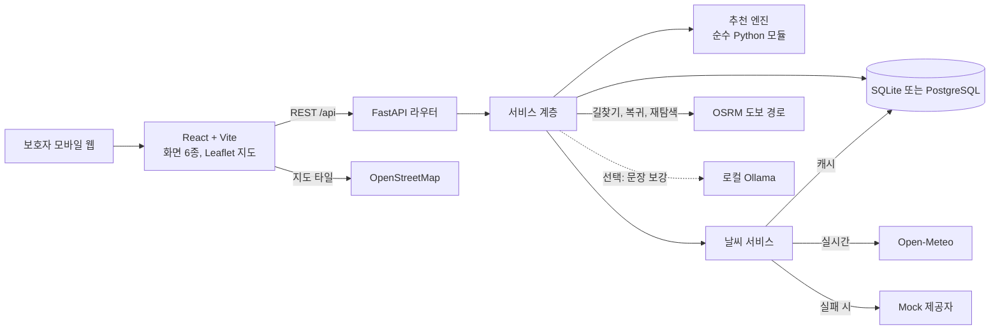
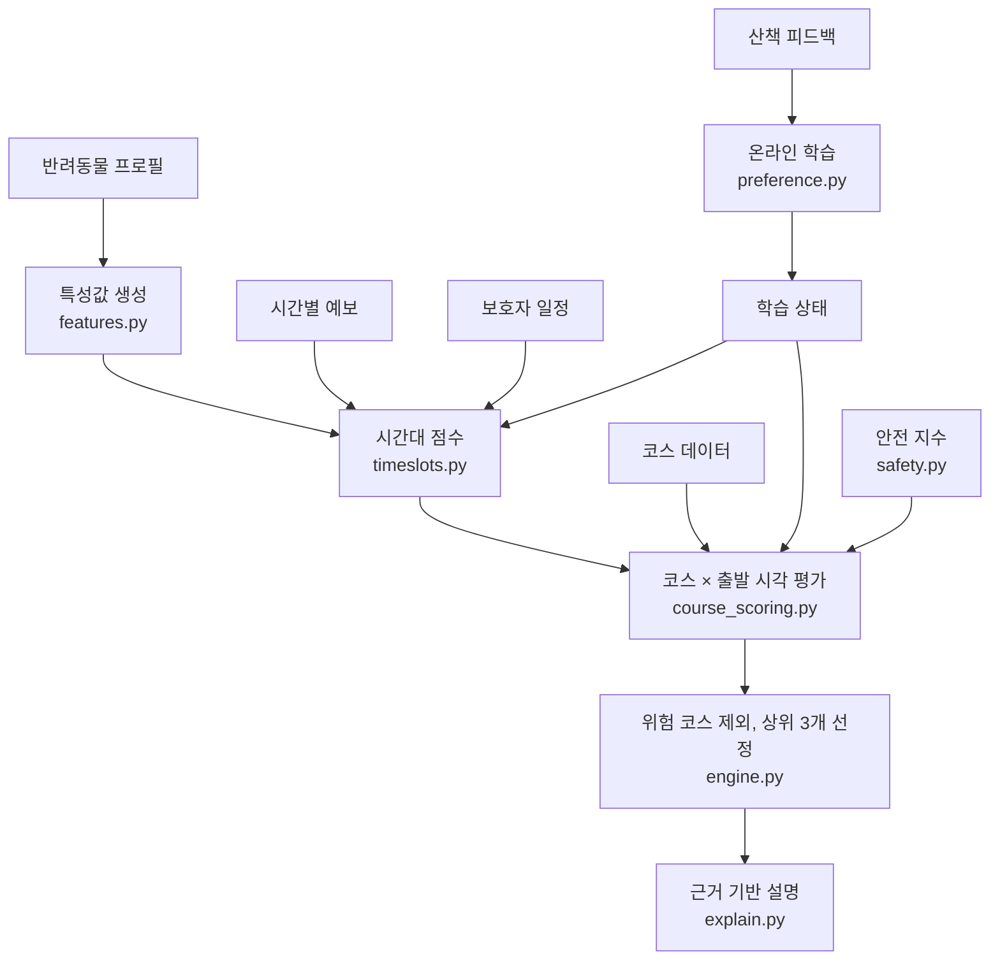
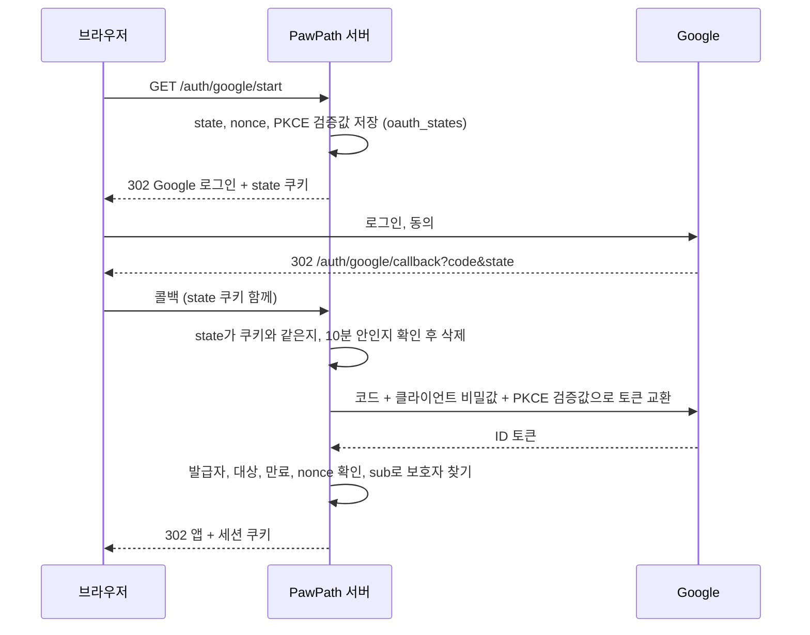
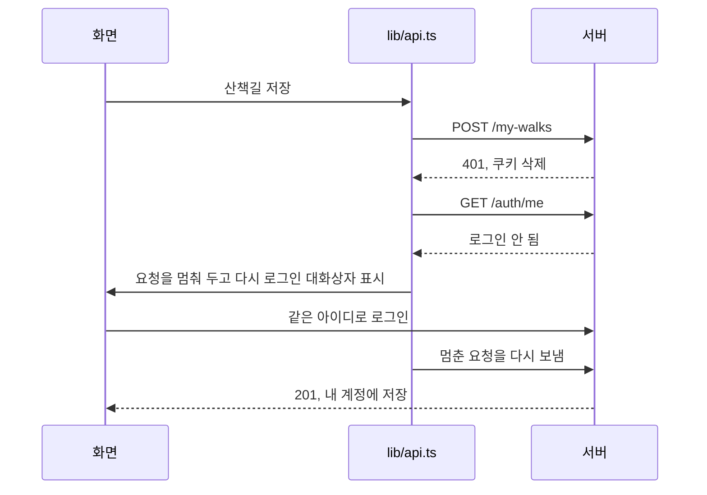
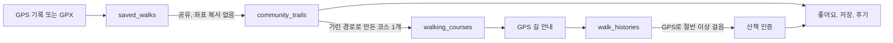
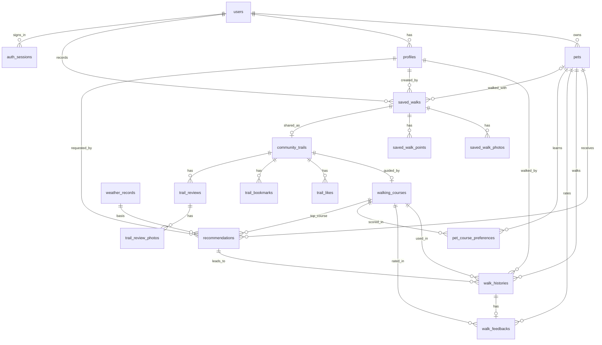

# PawPath 시스템 아키텍처

PawPath(댕댕 산책각)는 반려동물의 특성, 보호자의 일정, 날씨, 동네 환경을 함께 계산해 산책 시간과 코스를 추천하고, 산책 후 피드백을 학습해 다음 추천을 바꾸는 서비스입니다.

## 구성



| 계층 | 위치 | 역할 |
|---|---|---|
| 화면 | `frontend/src/pages` | 대시보드, 프로필, 추천, 지도, 산책 기록, 마이페이지 |
| API | `backend/app/api.py` | 요청 검증과 응답 구성 |
| 서비스 | `backend/app/services` | DB와 엔진 연결, 날씨 폴백, 피드백 반영 |
| 추천 엔진 | `backend/app/recommender` | 모든 추천 판단. DB와 웹 프레임워크에 의존하지 않음 |
| 코스 데이터 | `scripts/build_courses.py` → `backend/app/data/courses.json` | 경로와 시설을 미리 수집해 저장. 실행 중 외부 의존 없음 |

## 추천 파이프라인

> 지금 기본값은 **추천 v2**(`rule-v2`)입니다. 4단계 구조, 5개 묶음 가중치, 안전 단계, 피드백 조정, 평가 지표는 [추천 알고리즘](RECOMMENDER.md)에 있습니다. 아래의 3번 코스 점수와 가중치 표는 `RECOMMENDER_VERSION=v1`의 동작입니다. 특성값, 시간대 점수, 코스 선호 학습은 두 버전이 함께 씁니다.



### 1. 특성값 (`features.py`)

나이, 크기, 체중, 활동량, 성격, 산책 선호도, 더위 민감도, 낯선 환경 반응을 다음 값으로 변환합니다.

- 생애 단계(크기별 노령 기준), 권장 산책 시간과 거리
- 낯선 길 허용도, 혼잡 허용도, 오르막 허용도
- 쾌적 체감온도 구간과 산책 제외 온도

이 값들은 일반적인 산책 지침을 참고한 서비스 휴리스틱이며 수의학적 기준이 아닙니다.

### 2. 시간대 점수 (`timeslots.py`)

지금부터 24시간 안의 가능 시간대를 정시 단위로 평가합니다.

```
시간대 점수 = 0.55 × 날씨 쾌적도 + 0.15 × 일정 적합 + 0.10 × 일조 + 0.10 × 학습된 시간대 선호 + 0.10 × 가까운 시간
```

- 날씨 쾌적도는 체감온도, 강수, 바람, 자외선을 반려동물 기준으로 평가하며, 산책 구간의 평균과 최악값을 함께 봅니다.
- 강한 비(시간당 3mm 이상), 제외 온도, 강풍인 시간은 추천에서 제외합니다.
- 추위와 더위가 심하면 권장 시간을 줄이고, 비가 오기 전까지만 걷도록 시간을 맞춥니다.
- 산책 희망 횟수만큼, 3시간 이상 떨어진 시간대를 고릅니다.

### 3. 코스 점수 (`course_scoring.py`)

코스마다 가능한 출발 시각을 모두 평가해 가장 좋은 시각을 찾습니다. 각 항목은 0~100점이며 최종 점수는 가중합입니다.

| 항목 | 초기 가중치 | 계산 근거 |
|---|---:|---|
| 날씨 적합도 | 25% | 구간 쾌적도, 그늘, 포장 여부, 강변 바람, 비 겹침 |
| 반려동물 성향 적합도 | 25% | 익숙함과 낯선 길 허용도, 혼잡도, 성격별 선호 |
| 활동량 적합도 | 15% | 권장 거리 대비 코스 거리, 오르막. 추위와 더위에는 권장 거리를 줄임 |
| 보호자 일정 적합도 | 15% | 희망 시간 대비 소요 시간, 가능 시간 초과 여부 |
| 안전 시설 적합도 | 10% | 조명(해 진 뒤 비중 상승), 차량 노출, 공원, 포장, 확인된 시설 |
| 과거 선호도 | 10% (학습에 따라 최대 30%) | 학습된 코스 선호도. 피드백이 없으면 정확히 50점 |

다섯 항목의 가중치는 항상 고정입니다. 피드백이 n건 쌓이면 과거 선호도의 반영 강도만 `g = 10% + 20% × n/(n+2)`로 높입니다.

```
최종 점수 = Σ(가중치 × 항목 점수) + 10% × 50 + g × (과거 선호도 − 50)
```

피드백이 없으면 `g = 10%`이므로 기획서의 가중합과 정확히 같습니다. 중립값에서 벗어난 만큼만 강해지므로, 좋은 피드백은 항상 점수를 올리고 평가하지 않은 코스는 깎이지 않습니다.

### 4. 피드백 학습 (`preference.py`)

외부 AI 호출 없이 직접 구현한 온라인 학습입니다.

| 학습 대상 | 방식 | 효과 |
|---|---|---|
| 코스 선호도 | 최근 피드백 가중 베이즈 축소 평균 (사전값 50) | 표본이 적을 때 극단값을 막고, 최근 경험을 더 반영 |
| 코스 특성 가중치 | 정규화 LMS 선형 모델 (특성 11개) | 피드백이 비슷한 코스로 일반화되어, 가 보지 않은 코스도 예측 |
| 시간대 선호 | 시간대별 축소 평균 | 실제로 좋았던 시간대를 우선 |

피드백은 산책 만족도, 반려동물 만족도, 재방문 의향, 난이도를 합쳐 0~100점 신호로 바꿉니다. 코스 선호도에서는 날씨 만족도를 뺍니다. 비 오는 날의 나쁜 경험은 코스 탓이 아닐 수 있어서, 날씨가 나빴던 산책은 표본 가중치를 절반으로 줄입니다.

그 밖의 규칙은 다음과 같습니다.

- 익숙한 길을 좋아하는 반려동물은 좋았던 코스에 가산점을 받습니다.
- 새로운 길을 좋아하는 반려동물은 세 번 이상 간 코스에서 감점됩니다.
- 싫어한 코스는 자주 가도 "익숙해서 좋은 코스"로 치지 않습니다.

엔진은 같은 날씨에서 학습 상태만 비운 기준선을 함께 계산합니다. 응답의 `learning_delta`와 `rank_change`는 이 기준선과의 차이이므로 피드백의 효과만 보여 줍니다.

### 5. 추천 이유 (`explain.py`, `explain_guard.py`)

계산 결과와 코스 데이터로 문장을 조립합니다. 데이터에 없는 시설은 문장에 나올 수 없고, 팀 추정값을 사실처럼 말하지 않습니다. LLM을 켜면 이 사실들을 다듬은 문장을 검증해 쓰지만, 점수는 바뀌지 않습니다. 예:

> 낯선 길을 싫어하는 두부를 위해 익숙한 공원 코스를 골랐어요. 비가 오기 전 짧게 다녀올 수 있어요.

## GPS 길 안내

코스 안내 계산은 브라우저에서 합니다(`frontend/src/lib/navigation.ts`). 서버와 지도에 의존하지 않는 순수 모듈이라 테스트로 검증합니다.

| 단계 | 방식 |
|---|---|
| 위치 수집 | `watchPosition`. 오차 100m를 넘는 측정값은 진행도에 쓰지 않음 |
| 진행도 계산 | 현재 위치를 경로에 투영. 직전 진행도 근처부터 찾고 되돌아가지 않게 함 |
| 회전 안내 | 경로 좌표에서 꼭짓점 앞뒤 구간의 방향 차이로 좌회전, 우회전, 유턴을 판정. 40도 미만은 안내하지 않음 |
| 이탈 판정 | 코스에서 35m 초과 (GPS 정확도에 따라 최대 60m까지 완화) |
| 완주 판정 | 코스에 들어온 뒤 끝점 25m 이내 |
| 출발점 안내 | `POST /courses/{id}/approach`. 서버가 OSRM을 호출하고, 실패하면 직선으로 대체 |

왕복 코스는 같은 길을 두 번 지나므로 가장 가까운 점만 찾으면 진행도가 앞뒤로 튑니다. 그래서 탐색 범위를 직전 진행도 근처로 제한하고, 거리가 비슷하면 앞쪽을 택합니다. 반환점을 지나면 약 30~45m 뒤부터 복귀 구간으로 인식합니다.

**위치 정보:** 길 안내 중의 위치는 저장하지 않습니다. 길찾기 요청은 좌표가 접근 로그에 남지 않도록 본문으로 받고, 오류 로그에도 좌표를 남기지 않습니다. 외부로 나가는 경우는 출발점 3km 이내에서 길찾기를 요청할 때뿐입니다.

## 나만의 산책길과 GPX

사용자가 직접 기록하거나 GPX로 가져온 경로입니다. 추천 코스에 묶인 `walk_histories`를 바꾸지 않고 테이블 두 개를 더했습니다. 산책길은 `saved_walk_service.py`, GPX 읽기와 쓰기는 DB를 모르는 `gpx_service.py`가 맡습니다.

| 단계 | 방식 |
|---|---|
| 위치 수집 | 길 안내와 같은 `useGeolocation`(`watchPosition`). 시각은 좌표를 받은 시각을 씀. WebKit이 `position.timestamp`를 마이크로초로 주기 때문 |
| 오차 거르기 (`lib/recording.ts`) | 정확도 50m 초과, 제자리 흔들림(3m 또는 정확도의 절반, 최대 10m 미만 이동), 초속 12m를 넘는 30m 이상 이동을 버림. 튄 위치가 40m 안에 3번 연달아 찍히면 실제 위치로 보고 새 구간 시작 |
| 끊김 처리 | 60초 넘게 위치가 오지 않았다 돌아오면 새 구간. 구간 사이는 선을 잇지 않고 거리에 넣지 않음 |
| 유실 방지 | 좌표마다 `localStorage`에 임시 저장. 다시 열면 마지막 위치를 받은 시각 기준으로 일시정지해 닫혀 있던 시간을 빼고 복구. `client_id`로 재전송해도 한 번만 저장 |
| 서버 계산 | 거리와 평균 속도를 하버사인 거리로 다시 계산. 100m 넘게 움직이면서 시속 252km를 넘는 이동(시각이 없거나 같으면 5km 넘는 간격)은 구간을 나눔 |
| GPX 읽기 | 표준 라이브러리 expat. DOCTYPE과 엔티티 선언을 만나면 즉시 거부해 XXE와 엔티티 폭탄을 막음. 10MB, 10만 지점 제한. 확장 태그는 무시하고 좌표, 고도, 시각만 읽음 |
| GPX 쓰기 | GPX 1.1, UTF-8, 시각은 UTC. XML에 넣을 수 없는 제어 문자는 지움 |
| 공유 | `secrets.token_urlsafe(24)` 토큰(32자). 비공개면 토큰이 남아 있어도 열지 않음. 응답은 공유 전용 스키마로 만들어 개인정보 필드가 들어갈 자리가 없음 |

## 계정과 권한

모든 사용자 데이터 API는 `current_user` 하나로 주인(대표 계정)을 정하고, 반려동물과 산책길이 그 계정의 것인지 확인합니다. 로그인을 넣으면서 이 함수만 바꾸고 각 API의 권한 검사는 그대로 썼습니다.

### 대표 계정과 프로필

`users` 행이 대표 계정(가족 계정)이고 로그인 주체입니다. 그 안의 `profiles`가 넷플릭스처럼 가족 구성원을 나눕니다. 기존 `user_id` 기반 격리는 그대로 두고 그 위에 `profile_id`를 더했습니다. 계정 경계는 늘 `user_id`로 먼저 확인하고, 프로필은 그 안에서 누가 했는지와 목록 범위만 정합니다.

| 의존성 | 정하는 것 |
|---|---|
| `current_session` | 세션 쿠키. 만료면 `401` |
| `current_user` | 대표 계정. 데이터 소유 확인 |
| `current_profile` | 세션에 고른 프로필이 이 계정 소속이고 지우지 않았는지 요청마다 확인. 여럿인데 안 골랐으면 `428` |

- 반려동물과 학습 상태, 커뮤니티 글은 계정 단위(가족 공용)입니다. 커뮤니티에는 계정 이름만 나가고 프로필은 드러나지 않습니다.
- 산책 기록, 피드백, 추천, 나만의 산책길은 만든 프로필을 저장합니다. 목록은 지금 프로필 기준이고 `scope=family`로 가족 전체를 봅니다.
- 가족의 기록은 함께 보지만, 고치고 지우는 것은 만든 프로필이나 대표 프로필만 합니다.
- 일정은 사람마다 달라 프로필마다 둡니다. 추천과 날씨는 지금 프로필의 일정으로 계산합니다.
- 프로필 삭제는 `deleted_at`만 채워 기록이 누구의 것인지 남깁니다. 대표 프로필은 지울 수 없고(부분 고유 색인으로 계정마다 하나), 탈퇴하면 프로필도 함께 지웁니다.
- 프로필 전환은 세션 행의 `profile_id`만 바꿔 다시 로그인하지 않습니다. 화면은 전환할 때 페이지를 새로 그려 이전 프로필의 데이터가 남지 않게 합니다.

| 요청 | 보호자 |
|---|---|
| 유효한 세션 쿠키 | 그 계정 |
| 끝났거나 없는 세션 쿠키 | `401`, 쿠키 삭제. 시연 보호자로 넘기지 않음 |
| 쿠키 없음, `AUTH_REQUIRED=false` | 시연 보호자(id 1, 비밀번호 없어 로그인 불가) |
| 쿠키 없음, `AUTH_REQUIRED=true` | `401` |

Google 로그인은 OpenID Connect 승인 코드 흐름입니다(`google_auth_service.py`).



ID 토큰은 서버가 Google 토큰 엔드포인트에서 HTTPS로 직접 받으므로, Google 문서의 안내대로 서명 검증 없이 내용을 확인합니다. 이 덕분에 암호 라이브러리를 더하지 않았습니다. 브라우저가 건넨 ID 토큰은 받지 않습니다.

비밀번호는 scrypt(N=2^14, r=8, p=1)로 해시하고, 세션 토큰은 32바이트 무작위 값을 쿠키로만 주고 DB에는 SHA-256 값을 둡니다. 없는 아이디도 같은 해시 계산을 거쳐 응답 시간으로 아이디 존재 여부를 알 수 없게 했습니다. 사진은 `saved_walk_photos`에 바이트로 저장하며, 읽을 때 원본까지 불러오지 않도록 지연 로딩합니다.

### 세션 수명과 본인 재확인

| 규칙 | 값 | 동작 |
|---|---|---|
| 최대 수명 | 30일 | 로그인할 때 정하고 늘리지 않음. 계속 써도 끝남 |
| 유휴 만료 | 7일 | `last_seen_at` 기준. 요청마다 쓰지 않도록 5분 간격으로만 갱신 |
| 본인 재확인 | 10분 | 로그인이나 재확인 뒤 이 시간 안에만 탈퇴 가능. 확인하면 토큰을 바꿔, 쿠키를 훔친 사람은 권한을 얻지 못하고 세션에서 밀려남 |

비밀번호 재확인은 로그인과 따로 세어, 세션을 훔친 사람이 일부러 틀려 주인의 로그인을 막지 못합니다. Google 재확인은 로그인과 같은 PKCE, state, nonce 흐름에 `sub` 일치 확인을 더했습니다. Google 문서의 `prompt` 값은 `none`, `consent`, `select_account`뿐이라 비밀번호를 다시 묻게 강제할 수 없습니다.

세션이 끝나면 쿠키가 지워지므로, 화면이 그대로 다시 저장하면 누구나 보는 시연 보호자 계정에 들어갑니다. 그래서 화면은 시연 보호자로 넘어가지 않습니다.



기기에는 마지막 보호자의 번호, 아이디, 로그인 방식만 남겨, 브라우저를 닫았다 온 경우에도 만료를 알립니다. 직접 로그아웃하거나 탈퇴하면 지웁니다. 다른 계정으로 로그인하면 멈춘 요청을 버리고 앞사람의 임시 기록을 지웁니다.

### 계정 탈퇴

`account_service.delete_user_data`가 가리키는 쪽부터 차례로 지웁니다. SQLite는 외래 키를 검사하지 않아 `ON DELETE`가 동작하지 않으므로 명시적으로 지웁니다. 외래 키를 켠 연결에서도 순서가 맞는지 테스트합니다. 다른 보호자의 산책 기록이 가리키는 커뮤니티 코스는 행을 남기고 경로와 이름만 지웁니다.

`PRAGMA secure_delete`를 켜 지운 행을 파일에서 0으로 덮어씁니다. 기본값은 꺼져 있어 행을 지워도 내용이 파일의 빈 공간에 남습니다.

### 백업과 복구

`backup_service`가 SQLite 온라인 백업으로 사본을 만들고, 복구도 같은 방법으로 지금 DB를 트랜잭션으로 덮어씁니다. 파일을 바꿔치기하지 않으므로 복구 중에 멈춰도 깨지지 않고, 서버의 열린 연결도 새 내용을 읽습니다. 기준과 절차는 [백업 및 복구 정책](BACKUP.md)에 있습니다.

## 내 산책길을 추천 후보로

저장한 산책길을 `walking_courses`에 주인이 있는 코스로 만들어(`user_course_service.py`), 공용 코스와 같은 엔진, 길 안내, 피드백 학습을 그대로 씁니다.

| 단계 | 방식 |
|---|---|
| 경로 | 구간을 이어 하나의 경로로 만들고(사이가 100m 넘으면 거부) 4m 기준 더글러스-포이커로 단순화 |
| 지역 | 출발점이 서비스 지역 중심 5km 안이어야 함. 그 지역의 날씨로 추천하기 때문 |
| 시설 | 미리 수집한 OSM 시설에서 시드 코스와 같은 거리 기준(동물병원 200m, 그 밖 60m)으로 찾음 |
| 환경 측정 | 응답 뒤 백그라운드에서 Overpass로 경로 주변 길, 나무, 공원을 받아 시드 코스와 같은 함수(`environment_service.py`)로 측정. 다시 등록하면 이전 측정 결과는 버림 |
| 엔진 입력 | 측정값이 있으면 차량 노출, 조명, 노면, 그늘, 공원을 측정값에서 정함. 공원은 경로의 1% 이상이 공원 안이면 공원 코스(시드 코스 16개의 팀 판정과 맞춤) |
| 모르는 값 | 측정 전, 측정 실패, 측정할 수 없는 혼잡도와 경사는 `CourseData.unknown`에 넣음. 점수는 중립값으로 계산하되 안전 항목은 "확인 불가"(40점)로, 더운 날 그늘을 모르면 주의로 보고 긴 코스는 제외. 경사를 모르면 노령견과 어린 강아지에게 주의 문구 |
| 익숙함 | 직접 기록한 길은 반려견이 걸어 본 익숙한 길, 가져온 GPX는 낯선 길 |
| 권한 | 코스 목록과 조회, 길찾기, 주변 시설, 안전 평가, 산책 기록, 대체 경로 후보 모두 공용 코스와 보는 사람의 코스만 다룸 |

시드 코스는 `unknown`이 비어 있어 기존 추천 결과가 바뀌지 않습니다. OSM 측정 함수는 시드 코스를 만든 `scripts/enrich_courses.py`와 같은 모듈을 쓰며, 옮긴 뒤 스크립트로 개포동 데이터를 다시 만들어 한 글자도 달라지지 않음을 확인했습니다.

## 산책길 커뮤니티

기존 산책 경험을 잇는 계층입니다. `community_service.py`가 맡고, 경로는 `saved_walk_points`를 그대로 씁니다.



| 결정 | 이유 |
|---|---|
| `saved_walks.visibility`를 쓰지 않고 `community_trails`를 더함 | 원본 이름과 메모는 개인 기록이고, 기존 공유는 가리지 않은 경로를 내보냄. 공유 글은 자기 제목과 공개 값을 가져야 함. 산책길마다 1건(`saved_walk_id` 고유) |
| 좌표는 복사하지 않음 | 상세와 GPX는 요청 때 원본에서 가림. 목록에 쓰는 거리, 시간, 난이도, 출발점, 썸네일만 가린 뒤 계산해 저장 |
| 공유는 직접 기록과 GPX만 | 커뮤니티는 실제로 걸은 길을 나누는 곳. 자동 생성 경로(`generated`)는 아직 아무도 걷지 않아 서버와 화면에서 막음 |
| 반경 방식으로 가림 (`public_points`) | 앞뒤 거리만 자르면 집 앞을 다시 지나는 경로가 드러남. 반경 안의 지점을 모두 빼고 구간을 나눔. 지점이 드물면 두 지점 사이 선이 반경을 지나는지도 봄 |
| 가리는 반경은 주인에게만 알려 줌 | 반경을 알면 경로가 끊긴 곳들로 원본 출발점을 되짚을 수 있음 |
| 좋아요 수와 평점은 저장하지 않음 | 읽을 때 집계해 행과 어긋날 일이 없음. 고유 제약으로 중복을 막음 |
| 글을 쓰는 API는 `signed_in_user` | `current_user`는 로그인하지 않으면 시연 보호자라 쓰면 비로그인 제한이 뚫림. 보기는 `signed_in_viewer`로 시연 보호자와 분리 |
| 길 안내는 `walking_courses`로 연결 | 코스를 쓰는 길 안내, 산책 기록, 피드백, 리포트를 고치지 않고 재사용. 산책길마다 하나를 처음 시작할 때 만들고 `is_active=false`라 추천에 섞이지 않음. `_visible_course`가 산책길의 공개 상태를 따름 |
| 산책 인증은 강제가 아니라 표시 | `tracking_source`는 브라우저가 보내는 값이라 이것으로 글쓰기를 막으면 믿을 수 없는 관문이 됨. 일반 후기와 구분하고 읽을 때 계산해 기록을 지우면 떨어짐 |
| 공유를 거두면 코스의 경로, 이름, 주인을 지움 | 다른 보호자의 산책 기록이 코스를 가리키므로 행은 남기되 다시 열리지 않게 함 |
| 맞춤 추천은 기존 학습 재사용 | 표시된 특징을 `learned_attribute_weights`의 코스 특성에 대응시킴. 표시되지 않은 특징은 모르는 값이라 빼고, 근거에는 "보호자가 표시했다"고 밝힘 |

SQLite는 외래 키를 검사하지 않으므로 `ondelete`만 믿지 않습니다. 공유 해제와 원본 삭제는 ORM cascade로, 계정 탈퇴는 `user_delete_statements`로 지우고 테스트로 확인합니다.

## 안전 지수

`recommender/safety.py`가 항목별 상태(양호, 주의, 위험, 확인 불가)와 출처를 평가합니다.

| 항목 | 데이터 | 출처 |
|---|---|---|
| 기온, 강수, 바람, 자외선 | Open-Meteo | 예보 (시나리오면 모의) |
| 시간대 | 예보의 낮밤 정보 | 예보 |
| 조명 | OSM `lit` 태그. 경로의 50% 이상 기록이 있을 때만 사용 | OSM 기록, 없으면 확인 불가(팀 추정 병기) |
| 그늘 | OSM 나무 기록 근접 비율. 기록이 없으면 사실로 쓰지 않음 | OSM 기록, 없으면 확인 불가(팀 추정 병기) |
| 차량 노출 | OSM 도로 등급 비율 | OSM 기록 |
| 노면 | OSM `surface` 태그 | OSM 기록, 없으면 확인 불가(팀 추정 병기) |
| 주변 시설, 공원 | OSM | OSM 기록 |

- **점수:** 항목 점수의 가중 평균입니다. 낮에는 차량 노출과 날씨, 해가 진 뒤에는 조명 비중이 커집니다. 데이터가 없는 항목은 40점으로 계산해 안전하다고 보지 않습니다.
- **추천 제외(대체 코스 제안):** 강한 비·제외 체감온도·강풍인 시간대, 비 오는 시간의 비포장 코스, 쾌적 상한 +6°C 이상에서 30분을 넘는 산책 중 그늘을 확인할 수 없는 코스, 해가 진 뒤 조명이 부족한 코스(겁이 많거나 나이 든 경우), 초속 10m 이상 바람의 강변 코스.
- 안전 점수는 환경 위험을 비교하는 참고값이며 의학적, 절대적 안전을 보장하지 않습니다. 화면에도 표시합니다. v2의 안전 단계 적용 순서는 [추천 알고리즘](RECOMMENDER.md#안전-단계)에 있습니다.

## AI 추천 문장 (선택)

1. 추천 엔진이 순위와 점수를 확정해 저장합니다.
2. 화면은 계산 결과로 만든 문장을 먼저 보여 줍니다.
3. `POST /recommendations/{id}/explain`이 근거 자료(점수 제외)를 로컬 LLM(Ollama)에 보냅니다.
4. 돌아온 문장을 `explain_guard.py`가 검증합니다: 이름 포함, 길이, 단정 표현, 위치 표현, 확인 불가 항목, 근거 없는 시설과 숫자.
5. 통과한 문장만 `reason.llm_summary`에 저장합니다. 나머지는 처음 문장을 그대로 씁니다.

## 산책길 자동 생성

출발점과 산책 시간(20~90분)으로 순환 경로 후보를 만들어 비교하는 기능입니다(`POST /api/routes/generate`, 로그인 필요).

- **만드는 방식:** OSRM 도보 경로에 경유점 두 개(출발-A-B-출발)를 넣어 한 번에 순환 경로를 받습니다. 방위를 바꿔 가며 시도하고, 시간 오차(−20%~+50%), 되돌아오는 구간(25% 이하), 도로 보정 거리(150m 이하), 후보 간 겹침(65% 이하)을 넘지 못한 후보는 버립니다. 남은 후보가 없으면 억지로 만들지 않고 "만들지 못함"을 돌려줍니다. 기준 수치는 업계 표준이 아니라 팀이 실측으로 정한 값입니다.
- **반려동물 맞춤 평가:** 반려동물을 고르면 후보를 저장 코스와 같은 방식으로 `CourseData`로 바꿔 기존 추천 엔진에 넣습니다. 주변 도로·나무·공원은 요청마다 Overpass를 부르지 않고 미리 받아 둔 `backend/app/data/osm_<지역>.json`으로 측정합니다(공용 Overpass가 느리고 자주 실패해서). 자료가 덮지 않는 서비스 지역 밖은 "확인 불가"로 둡니다. 경사와 반려견 출입은 평가하지 않습니다.
- **공용 서버 보호:** 공용 OSRM 정책(초당 1회)에 맞춰 요청 간격 1.1초, 생성 1건 최대 30초, 동시에 한 건만 처리(진행 중이면 429), 계정별 대기 10초를 둡니다. 모두 `ROUTING_*`, `GENERATION_*` 환경변수로 바꿀 수 있어 OSRM을 직접 띄우면 코드 수정 없이 늘릴 수 있습니다. 로컬 OSRM에서는 요청 한 번이 약 5ms였고, 병목은 요청이 아니라 후보 평가 시간이었습니다.
- **개인정보:** 좌표는 계산에만 쓰고 로그와 DB에 남기지 않습니다. 사용자가 후보를 골라 저장할 때만 내 산책길(`source_type="generated"`)로 남습니다.

## 데이터 모델



| 테이블 | 내용 |
|---|---|
| `users` | 보호자, 산책 가능 시간, 희망 시간, 횟수, 로그인 아이디와 비밀번호 해시, Google 고유 ID와 이메일(시연 보호자는 모두 비어 있음) |
| `auth_sessions` | 로그인 세션. 토큰의 SHA-256 값, 만료 시각, 마지막 사용 시각, 본인 재확인 시각 (추가 테이블) |
| `oauth_states` | 진행 중인 Google 로그인. state의 SHA-256 값, nonce, PKCE 검증값, 돌아갈 경로, 만료 시각, 본인 재확인 대상. 한 번 쓰면 삭제 (추가 테이블) |
| `pets` | 프로필과 학습 상태(특성 가중치, 시간대 선호, 피드백 수) |
| `walking_courses` | 코스, 경로, 시설, 출처 정보 |
| `weather_records` | 시간별 날씨. 실제 날씨 캐시이자 추천 근거 |
| `recommendations` | 추천 결과 전문. 당시 점수와 근거를 보존 |
| `walk_histories` | 산책 기록 |
| `walk_feedbacks` | 피드백과 선호도 변화 전후 값. 산책 1회당 1건 |
| `pet_course_preferences` | 반려동물별 코스 선호도와 방문 수 (추가 테이블) |
| `saved_walks` | 나만의 산책길. 이름, 메모, 거리, 시간, 공개 범위, 공유 토큰과 기간, 중복 확인용 경로 해시, 썸네일 경로 (추가 테이블) |
| `saved_walk_points` | 산책길의 GPS 지점. 순서, 구간, 위경도, 고도, 시각, 정확도 (추가 테이블) |
| `saved_walk_photos` | 산책길 사진. 메타데이터를 지운 이미지와 형식, 크기 (추가 테이블) |
| `community_trails` | 공유한 산책길. 제목, 설명, 대표 사진 번호, 공개 여부, 지역, 특징, 추천 대상, 가리는 반경, 가린 뒤 계산한 거리, 시간, 오르막, 난이도, 출발과 도착, 썸네일, 조회수 (추가 테이블) |
| `trail_likes`, `trail_bookmarks` | 좋아요와 저장. 보호자와 산책길 조합이 고유 (추가 테이블) |
| `trail_reviews` | 후기. 별점 1~5(CHECK), 글. 보호자와 산책길 조합이 고유 (추가 테이블) |
| `trail_review_photos` | 후기 사진. 메타데이터를 지운 이미지 (추가 테이블) |

`walking_courses`에는 커뮤니티 산책길의 길 안내를 위해 `community_trail_id`(고유)를 더했습니다. `walking_courses`에는 내 산책길 코스를 위해 `owner_user_id`(주인, 공용 코스는 비어 있음), `saved_walk_id`(원본 산책길), `is_active`(추천 후보 여부)를 더했습니다. 산책 기록이 코스를 가리키므로 추천에서 빼거나 산책길을 지워도 코스는 지우지 않고 끕니다.

## 데이터 출처와 신뢰도

| 값 | 출처 | 표시 방식 |
|---|---|---|
| 경로, 거리 | OSRM 도보 경로 (OpenStreetMap 기반) | 실제 데이터 |
| 화장실, 음수대, 동물병원, 공원 위치 | OpenStreetMap | "확인된 시설" |
| 도로 유형(차량 노출), 조명, 노면, 나무 기록 | OpenStreetMap, 경로 10m 간격 측정 (`walking_courses.environment`) | "OSM 기록". 기록이 부족하면 "확인 불가" |
| 혼잡도, 그늘, 노면, 난이도, 동반 가능 여부 | 팀 추정값 | "추정" 표시, 현장 확인 안내 |
| 가로등, CCTV | 망원동 OSM 데이터 없음 (0건) | 사용하지 않음 |
| 주변 시설 8종 | OpenStreetMap (`data/places.json`) | 출처, 수집일, 기록 한계 표시 |

코스별 출처는 `walking_courses.data_sources`에 저장하고 API로 제공합니다.

## 장애 대응

| 상황 | 동작 |
|---|---|
| 날씨 API 실패 | Mock 날씨로 전환하고 화면에 안내 |
| 날씨 API 반복 호출 | DB 캐시 사용 (기본 30분) |
| 지도 타일 실패 | 배경 없이 경로와 시설 표시 유지 |
| LLM 꺼짐, 실패, 근거 없는 문장 | 템플릿 문장 유지, 점수 불변 |
| 길찾기 서버 실패 | 출발점까지 직선으로 표시하고 화면에 안내 |
| GPS 권한 거부, HTTPS 아님, 신호 없음 | 이유를 안내하고 시연용 걷기와 수동 기록 제공 |
| 화면 오류 | 빈 화면 대신 오류 경계가 안내와 홈 링크 표시 |
| 모든 시간대가 산책 부적합 | 코스 대신 제외 이유와 실내 대안 안내 |
| 피드백 중복 제출 | 409 응답, 학습에 반영하지 않음 |
| 산책 기록 중 새로고침, 앱 종료 | 기기에 임시 저장한 기록을 일시정지 상태로 복구 |
| 산책길 저장 중 네트워크 끊김 | 기록을 지우지 않고 다시 저장 안내. 같은 `client_id`라 중복 저장되지 않음 |
| 잘못된 GPX, 너무 큰 파일 | 이유를 담아 422, 413 응답. 저장하지 않음 |
| Google 로그인 실패, 취소 | 이유별로 로그인 화면에 안내. 서버 로그에는 이유만 남기고 코드와 토큰은 남기지 않음 |
| 로그인 세션 만료 | 401과 함께 쿠키 삭제. 화면은 시연 보호자로 넘어가지 않고 그 자리에서 다시 로그인을 받은 뒤 멈춘 요청을 이어서 보냄 |
| 탈퇴 기록을 남기지 못함 | 503, 아무것도 지우지 않음. 기록 없이 지우면 복구 때 되살아나기 때문 |
| 자동 백업 실패 | 서버는 계속 돌고 로그에 남김. 옛 백업을 지우지 않음 |
| DB 파일 손상, 분실 | `python -m app.backup restore`로 복구. 복구 전 파일은 따로 보관 |
| 사진 일부 업로드 실패 | 산책길은 저장된 채로 두고 실패한 장수를 상세 화면에 안내 |

## 현재 범위의 한계

- 로그인은 기본이 선택입니다. 로그인하지 않은 사용자는 모두 같은 시연 보호자 데이터를 쓰므로, 실서비스에서는 `AUTH_REQUIRED=true`로 운영해야 합니다. 비밀번호 찾기, 이메일 인증, 관리자 기능은 없습니다.
- 내 산책길 코스의 혼잡도와 경사는 측정하지 않습니다. 공원 측정은 OSM에서 선(way)으로 그린 공원 경계만 쓰므로, 관계(relation)로 그린 큰 공원이나 경계가 없는 숲(예: 성미산)은 공원으로 잡히지 않습니다.
- 아이디 계정과 Google 계정을 하나로 연결하는 기능은 없습니다. Google 로그인은 개발 서버(localhost)에서 확인했고, 휴대폰에서 쓰려면 고정 도메인을 콘솔에 등록해야 합니다.
- 로그인 시도 제한은 서버 메모리에 두어 재시작하면 초기화되고, 서버를 여러 대 띄우면 서버마다 따로 셉니다.
- 백업은 기본으로 DB와 같은 디스크에 두며, 원격 복사와 암호화는 없습니다. 자세한 내용은 [백업 및 복구 정책](BACKUP.md#한계)에 있습니다.
- 사진은 DB에 바이트로 저장합니다. 사진이 많아지면 별도 파일 저장소로 옮기는 편이 좋습니다.
- 웹 브라우저는 화면이 꺼지거나 다른 앱으로 넘어가면 위치 수집을 멈춥니다. 산책 기록은 그 구간을 거리에서 빼고 안내할 뿐, 백그라운드 기록은 하지 못합니다.
- 코스는 망원동과 개포동 두 지역뿐이며, 지역은 서버 설정 `SERVICE_AREA`로 전환합니다. 사용자별로 고를 수는 없습니다. 다른 지역은 `scripts/build_courses.py`의 경유지를 추가해 확장합니다.
- 혼잡도는 추정값이고, 조명과 그늘은 OSM 기록이 적어 대부분 확인 불가입니다. 공공데이터(가로등, CCTV)나 실측으로 보강해야 합니다.
- 산책 중 날씨 판단은 시간별 예보 기반이며 실시간 강수 감지가 아닙니다.
- PostgreSQL은 개발 DB로 백엔드 테스트와 브라우저 E2E를 통과했습니다. 지운 행이 VACUUM 전까지 데이터 파일에 남고, 자동 백업은 SQLite만 합니다. 상세는 [PostgreSQL 운영](POSTGRES.md)에 있습니다.
- LLM은 로컬 Ollama만 지원합니다. 학습 순위 모델은 구조만 분리했고 적용하지 않았습니다.
